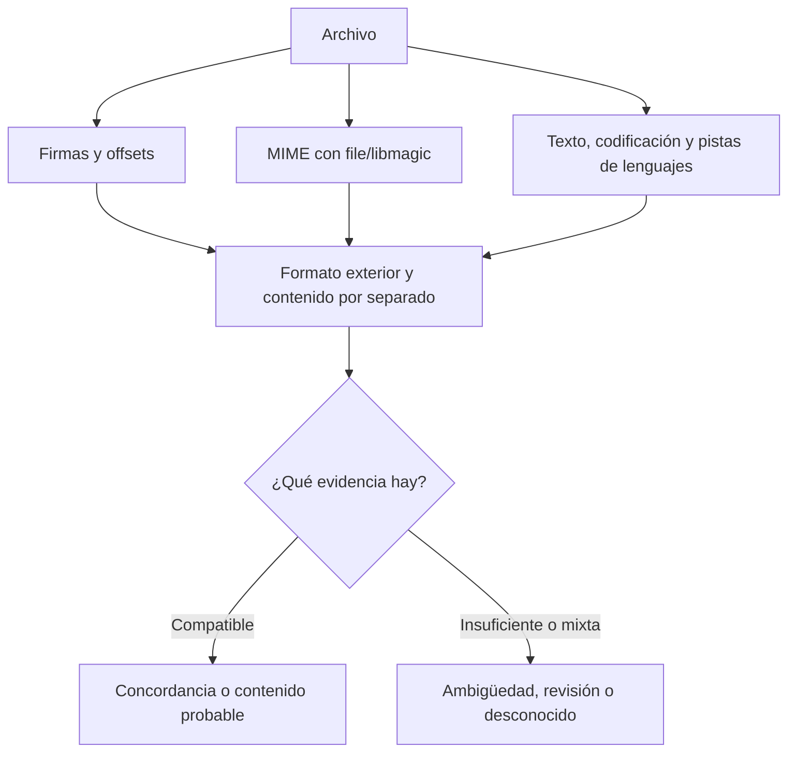

# 🔎 file_magic_number

**Identifica formatos, reconoce pistas de lenguajes y distingue el archivo del contenido que puede incluir.**

Herramienta en **Bash con un analizador local en Python 3** que combina tres capas en cada consulta: `file`/libmagic, una base independiente de firmas públicas y el análisis del contenido. No utiliza la extensión del nombre para decidir el formato o el lenguaje.

La versión **3.0.0** también puede reconocer PHP probable cuando `file` solo devuelve `ASCII text` o `text/plain`, incluidos fragmentos con `<?=`, saltos de línea y BOM. La representación hexadecimal permite inspeccionar los bytes; reconocer un lenguaje requiere además examinar sus delimitadores, tokens o sintaxis.

```console
$ ./file_magic_number imagen.php
Tipo orientativo: imagen PNG
Extensiones de la familia: png
MIME detectado: image/png
Resultado: CONCORDANTE: el MIME y los magic numbers son compatibles.
Estructura básica: pasó: IHDR inicial e IEND final; no se verificaron todos los bloques/CRC
Magic [S0175]: imagen PNG | byte 0 | patrón 89504e470d0a1a0a | observado 89504e470d0a1a0a
Muestra de contenido: 69/69 bytes | codificación: datos binarios
Nota de contenido: No se encontraron pistas suficientes de los lenguajes soportados en la muestra.
Alcance: identifica tipos probables; no garantiza validez completa ni seguridad.
```

En este ejemplo, `imagen.php` contiene un PNG real renombrado. El nombre no modifica la identificación.

## Instalación

Necesitas **Linux, Bash 4.4 o superior, Python 3.9 o superior, file/libmagic y GNU Coreutils**. Python solo utiliza su biblioteca estándar: no se necesita `pip`, Node ni instalar paquetes Python adicionales. El análisis funciona sin conexión y no envía archivos a servidores.

En Arch Linux:

```bash
sudo pacman -S --needed bash python file coreutils git
```

En Debian, Ubuntu o Kali:

```bash
sudo apt install bash python3 file coreutils git
```

Descarga el repositorio completo:

```bash
git clone https://github.com/david-rootbox/file_magic_number.git
cd file_magic_number
./file_magic_number "archivo.php"
```

**Conserva `data/` y `lib/` junto al script.** Descargar únicamente el ejecutable no es suficiente. Puedes invocarlo desde cualquier directorio o mediante un enlace simbólico al script original.

Si ya lo habías clonado:

```bash
git pull --ff-only
```

Si actualizas desde la versión 2, instala también Python 3 antes de ejecutarlo.

### Instalación para todos los usuarios en Arch Linux

```bash
sudo git clone https://github.com/david-rootbox/file_magic_number.git /opt/file_magic_number
sudo chmod 755 /opt/file_magic_number/file_magic_number
sudo chmod -R a+rX /opt/file_magic_number
sudo mkdir -p /usr/local/bin
sudo ln -s /opt/file_magic_number/file_magic_number /usr/local/bin/file_magic_number
file_magic_number --version
```

`/usr/local/bin` debe estar en el `PATH`. El enlace permite conservar todos los componentes en `/opt` y ejecutar el comando desde cualquier carpeta. Para actualizar esta instalación, usa `sudo git -C /opt/file_magic_number pull --ff-only`. No hace falta `sudo` para analizar archivos que tu usuario pueda leer.

## Uso

Identificación normal:

```bash
./file_magic_number "archivo.php"
```

Modo detallado, con todas las coincidencias, descripción de libmagic, tamaño y primeros 32 bytes:

```bash
./file_magic_number --verbose "archivo.php"
```

Para ampliar la muestra de contenido de 1 MiB a 4 MiB:

```bash
./file_magic_number --max-bytes 4194304 "archivo.bin"
```

`--max-bytes` acepta entre 4096 y 16777216 bytes. Las comprobaciones de firmas en offsets conocidos siguen siendo independientes de este límite de contenido.

Rutas con espacios y variables:

```bash
archivo="./mis archivos/imagen.bin"
./file_magic_number "$archivo"
```

Nombres que empiezan por guion:

```bash
./file_magic_number -- -archivo.bin
```

Ayuda y versión:

```bash
./file_magic_number --help
./file_magic_number --version
```

## Cuando file solo dice ASCII text

Para un archivo que contiene un salto de línea y `<?= $nombre ?>`, el análisis de contenido puede producir:

```text
Tipo orientativo: código PHP probable (.php)
MIME detectado: text/plain
Resultado: CONTENIDO PROBABLE: clasificación por texto/sintaxis; sin firma binaria única corroborante.
Estructura básica: no implementada para esta familia
Magic: sin coincidencias entre las 259 reglas de la base.
Muestra de contenido: 16/16 bytes | codificación: UTF-8/ASCII
Contenido: PHP | probable | documento | byte 1 | apertura <?= y tokens de código
Alcance: identifica tipos probables; no garantiza validez completa ni seguridad.
```

`text/plain` describe la detección original de libmagic. La nueva capa reconoce los indicadores de PHP por separado; no inventa un magic number binario para PHP ni cambia artificialmente el MIME que devolvió `file`.

## Lenguajes, datos y contenido mixto

| Contenido | Evidencia utilizada |
| --- | --- |
| PHP | Aperturas `<?php`/`<?=` y tokens del bloque; contempla saltos de línea, BOM y texto alrededor. |
| Python | Construcciones distintivas, shebang y, cuando el tamaño lo permite, análisis mediante `ast.parse`. |
| JavaScript / TypeScript | Combinaciones de construcciones, anotaciones de tipos, shebang o bloques `<script>`. La sintaxis compartida puede dejar ambas opciones abiertas. |
| Shell | Shebang o estructuras de control características. |
| HTML | Etiquetas del documento y elementos emparejados; distingue scripts de JavaScript, datos JSON y estilos. |
| XML / SVG | Parser XML para documentos pequeños sin DTD/ENTITY; también puede reconocer plantillas tras separar bloques PHP. |
| JSON | Parser estricto para objetos/arrays pequeños y completos; no acepta `NaN` como JSON válido. |
| SQL, CSS, C/C++ | Combinaciones de patrones propios de cada familia. |
| Markdown | Encabezados y bloques de ejemplo delimitados por tres acentos graves. |

Los shebang indican un intérprete declarado, no que el cuerpo sea válido. `ast.parse` permite reconocer una estructura de Python sin ejecutar el código; no valida todos los aspectos de alcance, tipos o comportamiento. El formato/lenguaje del archivo no se elige por la extensión.

### Separar el archivo de sus fragmentos

- Una plantilla puede mostrar **HTML + PHP + JavaScript** como capas distintas.
- Un objeto JSON con un ejemplo `<?php ... ?>` conserva la identificación JSON; el marcador PHP se presenta como texto citado.
- También se contemplan contextos citados en Python, JavaScript, shell y ejemplos Markdown. Son reglas conservadoras, no un analizador universal de todas las cadenas o comentarios.
- Si un PNG contiene pistas de PHP o código en una cadena legible, se conserva **imagen PNG** como formato y se informa el fragmento por separado. Esto no demuestra que sea un políglota ejecutable ni que el fragmento sea malicioso.
- La salida informa etiquetas y evidencias, sin imprimir automáticamente el código fuente encontrado. `--verbose` sigue mostrando la cabecera hexadecimal solicitada.

### Alcance del análisis de contenido

La muestra predeterminada es **1 MiB**, ampliable hasta **16 MiB**. Los marcadores PHP se buscan en toda la muestra, con un máximo de 64 bloques y hasta 64 KiB por bloque. Las reglas generales de lenguajes y los parsers trabajan en una ventana de hasta **131072 caracteres**; el parseo completo solo se intenta si el documento completo cabe en esa ventana y no se cortó la muestra.

Se reconocen UTF-8/ASCII, BOM de UTF-8/UTF-16/UTF-32 y algunos casos de UTF-16 sin BOM por la distribución de ceros. Detectar PHP representado en UTF-16 no significa que un servidor PHP vaya a interpretarlo directamente como código ejecutable.

En formatos binarios se examinan además hasta **16 cadenas legibles**, de hasta **16 KiB** cada una, dentro de la muestra. Sus coincidencias son pistas de contenido posible, no una reclasificación del contenedor. No se descomprimen archivos ni se inspecciona cada miembro de un ZIP.

El analizador de contenido tiene límites de CPU, memoria y tiempo: 5 segundos de CPU, 384 MiB de memoria virtual y un límite externo de 8 segundos antes de solicitar su terminación (con un segundo de margen antes de forzarla). No ejecuta ni importa el archivo analizado. Si no termina dentro de los límites, el comando informa un error en lugar de presentar una identificación completa.

## Flujo de identificación



Se leen inicialmente hasta **4096 bytes**. Para las reglas situadas más lejos o relativas al final, se consultan los rangos correspondientes sin cargar el archivo completo en memoria. El modo detallado solo muestra los primeros 32 bytes como resumen; esa no es la extensión total del análisis.

## Cómo interpretar la salida

| Resultado | Qué significa |
| --- | --- |
| `CONCORDANTE` | Una familia con firma de al menos cuatro bytes fijos concuerda con uno de sus MIME compatibles y no fallaron las comprobaciones básicas disponibles. |
| `CONCORDANTE EN FAMILIA` | Se reconoce el contenedor o familia. El MIME propone un tipo compatible, pero la firma no distingue el subtipo. |
| `EVIDENCIA PARCIAL` | Firma corta, cabecera insuficiente, MIME sin corroboración o comprobación básica fallida. |
| `SOLO MIME` | Libmagic propone un tipo, pero esta base no encontró una firma que lo corrobore. Es habitual con texto o código fuente. |
| `CONTENIDO PROBABLE` | La nueva capa reconoce un lenguaje o estructura textual aunque libmagic no lo identifique con precisión. |
| `REVISAR CONTENIDO` | Hay posibles fragmentos de código en un formato binario o pistas ambiguas de varios lenguajes. No significa automáticamente malware. |
| `CONTRADICCIÓN` | El MIME y una firma apuntan a familias incompatibles según los alias mantenidos en la tabla. Puede requerir revisar el archivo o los alias de la base. |
| `AMBIGUO` | Varias firmas de familias distintas coinciden o una firma es conocida por ser compartida. No se fuerza un único resultado. |
| `DESCONOCIDO` / `SIN EVIDENCIA` | No hay suficientes pistas para identificar un formato o el archivo está vacío. |

Las firmas cortas pueden ser auténticas: un GZIP puede quedar como evidencia parcial porque su regla tiene dos bytes fijos. Ese resultado conservador no significa que sea malicioso o inválido. Las familias sin alias MIME mantenidos se muestran como candidatas por firma, sin inventar una corroboración.

**Un MIME reconocido no evita la comparación de firmas.** Del mismo modo, encontrar una firma no anula una contradicción del MIME.

### Firmas compartidas y contenedores

- `50 4B 03 04` corresponde a un contenedor ZIP, utilizado también por formatos como DOCX, JAR y APK. No se elige un subtipo por el nombre del archivo.
- `D0 CF 11 E0 A1 B1 1A E1` identifica la familia OLE/CFB; no significa automáticamente que sea un documento Word.
- `CA FE BA BE` puede corresponder a Java class o Mach-O universal: el resultado permanece ambiguo.
- El texto plano y el código PHP no tienen una firma binaria universal que confirme su formato en todos los casos.

## Códigos de salida

| Código | Significado |
| --- | --- |
| `0` | MIME y firma compatibles, a nivel de formato o de familia. |
| `1` | Evidencia parcial, contenido textual probable, solo MIME, archivo vacío o formato desconocido. |
| `2` | Error de argumentos, dependencia, lectura o base de datos. |
| `3` | Contradicción, ambigüedad o contenido adicional que requiere revisión. |

**Cambio respecto a v1:** reconocer solamente el MIME o una firma ya no devuelve necesariamente `0`. No uses estos códigos como autorización para ejecutar, abrir o aceptar automáticamente una subida.

La detección textual puede ser útil y correcta aunque devuelva `1`: PHP probable sigue siendo una hipótesis basada en contenido, sin una firma binaria universal. El código `0` conserva el significado de compatibilidad MIME/firma y no excluye contenido adicional que el muestreo no haya encontrado.

## Procedencia de las firmas

La base pública elegida es [TheDiscordian/magic-bytes](https://github.com/TheDiscordian/magic-bytes), revisión [`26e7a9bd21d6b9d08740fb91b4a0f49754daacdb`](https://github.com/TheDiscordian/magic-bytes/tree/26e7a9bd21d6b9d08740fb91b4a0f49754daacdb). El proyecto original declara basarse en una lista pública de firmas de archivos.

| Archivo | Contenido |
| --- | --- |
| `data/upstream/rows_map.json` | Datos originales de firmas y continuaciones. |
| `data/upstream/offset_list.json` | Firmas originales con offsets absolutos o relativos al final. |
| `data/upstream/source.json` | Revisión, hashes SHA-256 y hashes de blobs de origen. |
| `data/upstream/LICENSE` | Licencia MIT de la base incorporada. |
| `data/signatures.tsv` | Reglas normalizadas que consume Bash. |
| `data/import-report.json` | Reglas/familias resultantes y entradas excluidas con sus motivos. |
| `tools/build_signatures.py` | Conversión reproducible de JSON a TSV, etiquetas, alias MIME y correcciones locales. |
| `lib/content_probe.py` | Decodificación, parsers pasivos y reglas de contenido/lenguajes, independientes de la extensión. |

La conversión conserva las continuaciones como patrones con comodines, elimina marcas triviales y corrige la presentación de firmas compartidas. Las adiciones locales explícitas incluyen el marcador genérico JPEG y la familia ISO BMFF. Los alias MIME y tamaños mínimos son metadatos mantenidos por este proyecto, no una afirmación de que el dataset original valide esos formatos.

No se descarga ni ejecuta código remoto durante el análisis. La copia local permite resultados reproducibles y funcionamiento sin Internet. No se promete que la base contenga todos los formatos ni que todas sus entradas sean perfectas.

### Reconstruir la tabla

Para mantenimiento o desarrollo se necesita **Python 3** con su biblioteca estándar:

```bash
python3 tools/build_signatures.py
```

El generador verifica los SHA-256 de las fuentes locales antes de generar la tabla. No descarga datos. Para adoptar una nueva revisión externa, revisa sus archivos y licencia, actualiza las fuentes y su procedencia y vuelve a generar y probar; no basta con cambiar el hash de revisión.

Para recibir las actualizaciones publicadas en este repositorio, usa `git pull --ff-only`. Mantén también actualizado el paquete `file` de tu distribución: su base libmagic es una fuente distinta de la tabla incorporada.

## Pruebas

```bash
bash -n file_magic_number
python3 tests/test_detector.py
```

Las **77 pruebas** generan archivos temporales y comprueban PNG renombrados, cabeceras falsas o truncadas, contradicciones MIME simuladas, firmas compartidas, ZIP, SQLite, ELF, TAR, comodines RIFF, offsets de DICOM/ISO/DMG, texto, vacíos, nombres especiales, enlaces y bases inválidas. También verifican PHP corto con MIME genérico, BOM/UTF-16/UTF-32, fragmentos posteriores a la cabecera, lenguajes mixtos, código citado, parsers, límites de muestra y que los ejemplos de código no se ejecuten. No necesitan Internet ni dependencias Python externas. Son pruebas de comportamiento, no una medición estadística de precisión sobre todos los formatos y lenguajes.

## Límites de fiabilidad

La concordancia es evidencia de identificación, **no una certificación de integridad o seguridad**. Libmagic también usa firmas: combinar ambas fuentes no las convierte en pruebas estadísticamente independientes ni justifica un porcentaje de certeza.

Las comprobaciones básicas actuales para imágenes son limitadas: PNG exige un primer IHDR de longitud 13 y un IEND al final, y JPEG comprueba un cierre EOI final. No se verifican todos los CRC, segmentos, tamaños internos o píxeles. Un JPEG con datos legítimos añadidos tras EOI puede quedar como parcial. Para las demás familias se informa que no se implementó una comprobación estructural adicional.

Las reglas de lenguajes son heurísticas limitadas. Pueden confundir ejemplos, código incompleto o lenguajes de sintaxis parecida, y no reconocen todos los lenguajes o dialectos. Encontrar tokens de código en una cadena no determina qué intérprete utilizará un servidor.

Los archivos políglotas, contenido incrustado, datos cifrados y estructuras falsificadas pueden requerir herramientas especializadas. El script no busca todas las firmas binarias arbitrarias en cada byte, no descomprime contenedores, no garantiza descubrir un políglota y no es un antivirus ni un validador de subidas.

## Referencias adicionales

- [Documentación de file/libmagic](https://github.com/file/file/blob/master/doc/file.man)
- [Especificación PNG — firma y estructura](https://www.w3.org/TR/png-3/)
- [GCK File Signatures — SEARCH](https://filesig.search.org/)
- [Etiquetas PHP, incluida la apertura corta de echo](https://www.php.net/manual/en/language.basic-syntax.phptags.php)
- [Análisis AST de Python](https://docs.python.org/3/library/ast.html)
- [Parser JSON de Python](https://docs.python.org/3/library/json.html)
