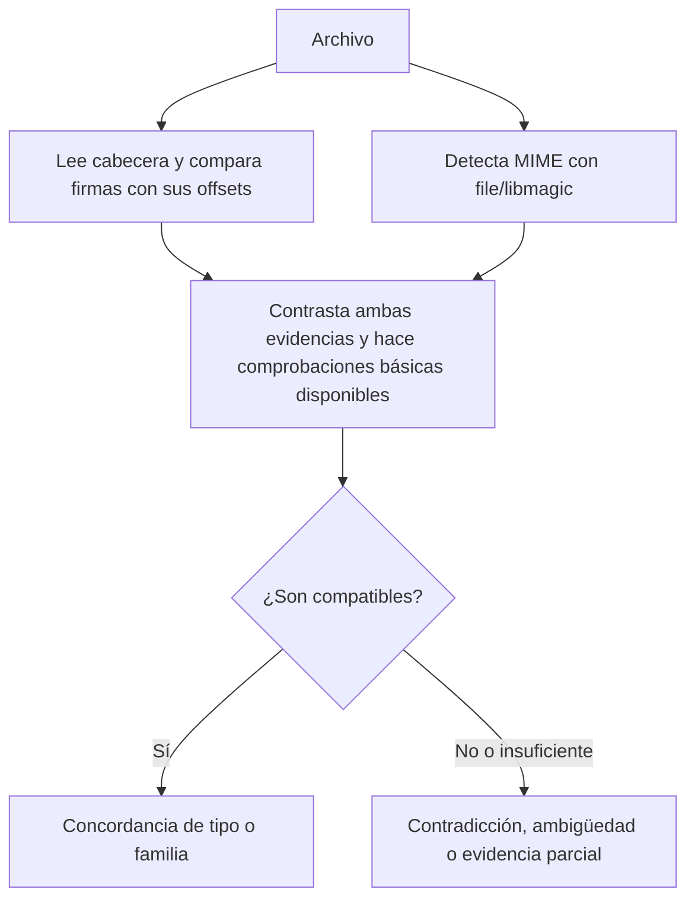

# 🔎 file_magic_number

**Identifica formatos por su contenido y comprueba si el MIME y los magic numbers concuerdan.**

Herramienta en **Bash** que contrasta dos fuentes de evidencia en cada consulta: el resultado de `file`/libmagic y una base independiente de firmas públicas. No utiliza la extensión del nombre para decidir el formato.

```console
$ ./file_magic_number imagen.php
Tipo orientativo: imagen PNG
Extensiones de la familia: png
MIME detectado: image/png
Resultado: CONCORDANTE: el MIME y los magic numbers son compatibles.
Estructura básica: pasó: IHDR inicial e IEND final; no se verificaron todos los bloques/CRC
Magic [S0175]: imagen PNG | byte 0 | patrón 89504e470d0a1a0a | observado 89504e470d0a1a0a
Alcance: identifica tipos probables; no garantiza validez completa ni seguridad.
```

En este ejemplo, `imagen.php` contiene un PNG real renombrado. El nombre no modifica la identificación.

## Qué cambia en la versión 2

- **Siempre compara las firmas**, aunque libmagic ya haya identificado el MIME.
- Incorpora una base local de **259 reglas para 201 familias** derivada de [TheDiscordian/magic-bytes](https://github.com/TheDiscordian/magic-bytes), con su licencia MIT, revisión y hashes de procedencia.
- Comprueba posiciones absolutas, offsets desde el final y bytes variables. No se limita al byte cero ni a los primeros 32 bytes.
- Expone el MIME, los patrones coincidentes y su posición incluso en el modo normal.
- Distingue concordancia, evidencia parcial, ambigüedad y contradicción.
- Trata ZIP, OLE/CFB, EBML, ar e ISO BMFF como **familias o contenedores**. La firma por sí sola no identifica necesariamente su subtipo.
- Evita convertir marcadores de un byte, relleno de ceros o marcas de codificación en una identificación de formato. Las firmas cortas conservadas solo aportan evidencia parcial.
- Añade comprobaciones básicas de apertura/cierre para PNG y del cierre EOI para JPEG. No realiza una validación completa de esas imágenes.
- Incluye **35 pruebas de regresión** reproducibles.

## Instalación

Necesitas **Linux, Bash 4.4 o superior, file/libmagic y GNU Coreutils**. La ejecución normal no requiere Python, Node, acceso a Internet ni subir archivos a servidores.

En Arch Linux:

```bash
sudo pacman -S bash file coreutils git
```

En Debian, Ubuntu o Kali:

```bash
sudo apt install bash file coreutils git
```

Descarga el repositorio completo:

```bash
git clone https://github.com/david-rootbox/file_magic_number.git
cd file_magic_number
./file_magic_number "archivo.php"
```

**Conserva `data/` junto al script.** Descargar únicamente el ejecutable ya no es suficiente. Puedes invocarlo desde cualquier directorio o mediante un enlace simbólico al script original.

Si ya lo habías clonado:

```bash
git pull --ff-only
```

## Uso

Identificación normal:

```bash
./file_magic_number "archivo.php"
```

Modo detallado, con todas las coincidencias, descripción de libmagic, tamaño y primeros 32 bytes:

```bash
./file_magic_number --verbose "archivo.php"
```

Rutas con espacios y variables:

```bash
archivo="./mis archivos/imagen.bin"
./file_magic_number "$archivo"
```

Nombres que empiezan por guion:

```bash
./file_magic_number -- -archivo.bin
```

Ayuda y versión:

```bash
./file_magic_number --help
./file_magic_number --version
```

## Flujo de identificación



Se leen inicialmente hasta **4096 bytes**. Para las reglas situadas más lejos o relativas al final, se consultan los rangos correspondientes sin cargar el archivo completo en memoria. El modo detallado solo muestra los primeros 32 bytes como resumen; esa no es la extensión total del análisis.

## Cómo interpretar la salida

| Resultado | Qué significa |
| --- | --- |
| `CONCORDANTE` | Una familia con firma de al menos cuatro bytes fijos concuerda con uno de sus MIME compatibles y no fallaron las comprobaciones básicas disponibles. |
| `CONCORDANTE EN FAMILIA` | Se reconoce el contenedor o familia. El MIME propone un tipo compatible, pero la firma no distingue el subtipo. |
| `EVIDENCIA PARCIAL` | Firma corta, cabecera insuficiente, MIME sin corroboración o comprobación básica fallida. |
| `SOLO MIME` | Libmagic propone un tipo, pero esta base no encontró una firma que lo corrobore. Es habitual con texto o código fuente. |
| `CONTRADICCIÓN` | El MIME y una firma apuntan a familias incompatibles según los alias mantenidos en la tabla. Puede requerir revisar el archivo o los alias de la base. |
| `AMBIGUO` | Varias firmas de familias distintas coinciden o una firma es conocida por ser compartida. No se fuerza un único resultado. |
| `DESCONOCIDO` / `SIN EVIDENCIA` | No hay suficientes pistas para identificar un formato o el archivo está vacío. |

Las firmas cortas pueden ser auténticas: un GZIP puede quedar como evidencia parcial porque su regla tiene dos bytes fijos. Ese resultado conservador no significa que sea malicioso o inválido. Las familias sin alias MIME mantenidos se muestran como candidatas por firma, sin inventar una corroboración.

**Un MIME reconocido no evita la comparación de firmas.** Del mismo modo, encontrar una firma no anula una contradicción del MIME.

### Firmas compartidas y contenedores

- `50 4B 03 04` corresponde a un contenedor ZIP, utilizado también por formatos como DOCX, JAR y APK. No se elige un subtipo por el nombre del archivo.
- `D0 CF 11 E0 A1 B1 1A E1` identifica la familia OLE/CFB; no significa automáticamente que sea un documento Word.
- `CA FE BA BE` puede corresponder a Java class o Mach-O universal: el resultado permanece ambiguo.
- El texto plano y el código PHP no tienen una firma binaria universal que confirme su formato en todos los casos.

## Códigos de salida

| Código | Significado |
| --- | --- |
| `0` | MIME y firma compatibles, a nivel de formato o de familia. |
| `1` | Evidencia parcial, solo MIME, archivo vacío o formato desconocido. |
| `2` | Error de argumentos, dependencia, lectura o base de datos. |
| `3` | Contradicción o ambigüedad. |

**Cambio respecto a v1:** reconocer solamente el MIME o una firma ya no devuelve necesariamente `0`. No uses estos códigos como autorización para ejecutar, abrir o aceptar automáticamente una subida.

## Procedencia de las firmas

La base pública elegida es [TheDiscordian/magic-bytes](https://github.com/TheDiscordian/magic-bytes), revisión [`26e7a9bd21d6b9d08740fb91b4a0f49754daacdb`](https://github.com/TheDiscordian/magic-bytes/tree/26e7a9bd21d6b9d08740fb91b4a0f49754daacdb). El proyecto original declara basarse en una lista pública de firmas de archivos.

| Archivo | Contenido |
| --- | --- |
| `data/upstream/rows_map.json` | Datos originales de firmas y continuaciones. |
| `data/upstream/offset_list.json` | Firmas originales con offsets absolutos o relativos al final. |
| `data/upstream/source.json` | Revisión, hashes SHA-256 y hashes de blobs de origen. |
| `data/upstream/LICENSE` | Licencia MIT de la base incorporada. |
| `data/signatures.tsv` | Reglas normalizadas que consume Bash. |
| `data/import-report.json` | Reglas/familias resultantes y entradas excluidas con sus motivos. |
| `tools/build_signatures.py` | Conversión reproducible de JSON a TSV, etiquetas, alias MIME y correcciones locales. |

La conversión conserva las continuaciones como patrones con comodines, elimina marcas triviales y corrige la presentación de firmas compartidas. Las adiciones locales explícitas incluyen el marcador genérico JPEG y la familia ISO BMFF. Los alias MIME y tamaños mínimos son metadatos mantenidos por este proyecto, no una afirmación de que el dataset original valide esos formatos.

No se descarga ni ejecuta código remoto durante el análisis. La copia local permite resultados reproducibles y funcionamiento sin Internet. No se promete que la base contenga todos los formatos ni que todas sus entradas sean perfectas.

### Reconstruir la tabla

Para mantenimiento o desarrollo se necesita **Python 3** con su biblioteca estándar:

```bash
python3 tools/build_signatures.py
```

El generador verifica los SHA-256 de las fuentes locales antes de generar la tabla. No descarga datos. Para adoptar una nueva revisión externa, revisa sus archivos y licencia, actualiza las fuentes y su procedencia y vuelve a generar y probar; no basta con cambiar el hash de revisión.

Para recibir las actualizaciones publicadas en este repositorio, usa `git pull --ff-only`. Mantén también actualizado el paquete `file` de tu distribución: su base libmagic es una fuente distinta de la tabla incorporada.

## Pruebas

```bash
bash -n file_magic_number
python3 tests/test_detector.py
```

Las pruebas generan archivos temporales y comprueban PNG renombrados, cabeceras falsas o truncadas, contradicciones MIME simuladas, firmas compartidas, ZIP, SQLite, ELF, TAR, comodines RIFF, offsets de DICOM/ISO/DMG, texto, vacíos, nombres especiales, enlaces y bases inválidas. No necesitan Internet ni dependencias Python externas.

## Límites de fiabilidad

La concordancia es evidencia de identificación, **no una certificación de integridad o seguridad**. Libmagic también usa firmas: combinar ambas fuentes no las convierte en pruebas estadísticamente independientes ni justifica un porcentaje de certeza.

Las comprobaciones básicas actuales para imágenes son limitadas: PNG exige un primer IHDR de longitud 13 y un IEND al final, y JPEG comprueba un cierre EOI final. No se verifican todos los CRC, segmentos, tamaños internos o píxeles. Un JPEG con datos legítimos añadidos tras EOI puede quedar como parcial. Para las demás familias se informa que no se implementó una comprobación estructural adicional.

Los archivos políglotas, contenido incrustado, datos cifrados y estructuras falsificadas pueden requerir herramientas especializadas. El script no busca firmas arbitrarias en cada byte, no descomprime contenedores, no garantiza descubrir un políglota y no es un antivirus ni un validador de subidas.

## Referencias adicionales

- [Documentación de file/libmagic](https://github.com/file/file/blob/master/doc/file.man)
- [Especificación PNG — firma y estructura](https://www.w3.org/TR/png-3/)
- [GCK File Signatures — SEARCH](https://filesig.search.org/)
